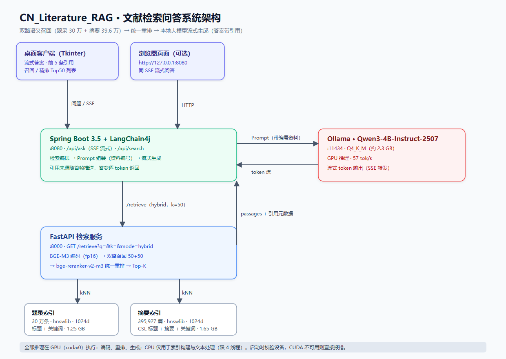

# 文献检索问答系统（CN_Literature_RAG）

面向中文文献的 **检索增强生成（RAG）** 问答系统：语义召回 + 重排 + 本地大模型生成，答案附可溯源的引用。

由 2023–2024 年的「搜索排序系统」演进而来——检索链路升级为 BGE-M3 双索引，并在其上增加生成层与服务化。



## 核心特性

- **双路召回**：30 万条题录（标题+关键词）+ 39.6 万篇 CSL 中文论文摘要，两套 HNSW 索引并行召回
- **统一重排**：bge-reranker-v2-m3 跨编码器对混合候选统一打分，跨粒度可比
- **流式生成**：Qwen3-4B-Instruct（Ollama，Q4）流式输出，答案按 [1][2] 标注引用
- **服务化**：FastAPI 检索微服务 + Spring Boot 3.5 / LangChain4j 编排（SSE 推送）
- **桌面客户端**：Tkinter 窗口，流式答案 + 前 5 条引用 + 完整召回/精排列表
- **全 GPU 推理**：编码、重排、生成均在 cuda:0 上运行，CUDA 不可用时直接报错而非静默回退 CPU

## 效果指标

| 指标 | 数值 | 说明 |
|---|---|---|
| 标题级 recall@20 | **0.879** | 旧 ERNIE-1.0 基线 0.770（+11.0 pt，同 dev.csv 19,940 对） |
| 重排 AUC | 0.694 / 0.755 | 中位数 / 阈值 0.7 二值化（1,000 对，gold 为距离） |
| RAG 检索命中 @5 | **95%** | 60 题合成评测集 |
| RAG 引用命中 @5 | **95%** | 完整问答链路，引用含 gold 摘要 |
| 检索耗时 | **0.76 s** | 双路 100 候选 + 重排（GPU，fp16） |
| 生成速度 | **57 tok/s** | RTX 4060 Laptop 8GB，Q4_K_M |

详见 [docs/retrieval_upgrade.md](docs/retrieval_upgrade.md) 与 [docs/rag_eval.md](docs/rag_eval.md)。

## 快速开始

**前置**：Python 3.11（conda 环境 `rag`）、PyTorch 2.5.1+cu121、Java 21、Maven 3.9、[Ollama](https://ollama.com) 及 `qwen3:4b-instruct-2507-q4_K_M`。

```bash
# 1) 生成模型
ollama serve
ollama pull qwen3:4b-instruct-2507-q4_K_M

# 2) 检索服务（首次加载索引约 40–60 秒）
conda activate rag
cd retrieval
python -m uvicorn service:app --host 127.0.0.1 --port 8000

# 3) 应用服务（另开终端）
cd rag-service
mvn -s maven-settings.xml package -DskipTests   # 国内需走镜像
java -jar target/rag-service-1.0.0.jar

# 4) 桌面客户端（另开终端）
cd rag_app
python app.py
```

Windows 下可用本地一键脚本 `启动RAG.bat`（自动拉起上述三个服务 + 客户端；脚本含本机路径，未纳入版本库）。

网页版入口：启动服务后访问 <http://127.0.0.1:8080/>。

## 目录结构

```
├── rag_app/                 # 桌面客户端（Tkinter）
│   ├── app.py               #   主窗口：流式答案、引用 chips、召回/精排结果窗口
│   └── rag_client.py        #   HTTP 客户端（/retrieve + SSE 解析）
├── rag-service/             # 应用层：Spring Boot 3.5 + LangChain4j
│   └── src/main/java/com/searchrank/rag/
│       ├── client/          #   调用 Python 检索服务
│       ├── service/         #   Prompt 组装 + 流式生成
│       └── web/             #   /api/ask（SSE）、/api/search
├── retrieval/               # 检索层（Python）
│   ├── service.py           #   FastAPI：双路召回 + 重排
│   ├── build_title_index.py #   30 万题录索引构建
│   ├── build_doc_index.py   #   39.6 万 CSL 摘要索引构建
│   ├── eval_*.py            #   召回/AUC/端到端评测
│   └── data/                #   索引与语料（本地生成，未上传）
├── docs/                    # 架构说明、升级与评测报告
├── rank/ recall/ search_system/ desktop_app/   # 2023 旧实现（Paddle/ERNIE，保留作基线）
└── requirements.txt
```

## 数据与模型

| 资源 | 规模 | 说明 |
|---|---|---|
| 题录语料 | 300,000 条 | PaddleNLP `literature_search_data`（标题+关键词） |
| 摘要语料 | 395,927 篇 | [CSL 中文科学文献](https://huggingface.co/datasets/neuclir/csl)（标题+摘要+关键词） |
| 向量模型 | BGE-M3 | 1024 维 dense，L2 归一化 |
| 重排模型 | bge-reranker-v2-m3 | cross-encoder |
| 生成模型 | Qwen3-4B-Instruct-2507 | Ollama，Q4_K_M，约 2.3GB |

> 实测两套语料标题重叠率约 **0.6%**：来源不同、互为补充——题录库用于"找文献"，摘要库用于"读内容答问题"。
> 语音索引与模型权重体积较大未入库，用 `retrieval/build_*.py` 重建（BGE-M3 / reranker 从 HuggingFace 下载）。

## 演进说明

| 阶段 | 时间 | 技术栈 | 产出 |
|---|---|---|---|
| 检索排序系统 | 2023.09–2024.11 | PaddlePaddle · ERNIE-1.0 双塔 · ERNIE-3.0 pairwise · hnswlib | recall@20 0.770，AUC 0.694–0.755 |
| RAG 升级 | 2025–2026 | BGE-M3 · bge-reranker · Qwen3-4B · FastAPI · Spring Boot/LangChain4j | recall@20 0.879，RAG 命中 95% |

旧实现完整保留在 `rank/`、`recall/`、`search_system/`、`desktop_app/`，已切换为 GPU 运行，可直接复现基线。

## 环境说明

- 检索服务强制 GPU：启动时校验 `encoder.device` / `reranker.device`，非 `cuda` 直接报错
- CPU 仅用于索引构建（hnswlib 无 CUDA 实现）与文本处理，默认限制 4 线程（`RAG_THREADS` 可调）
- 服务进程以低于正常优先级运行，避免占满 CPU
- 显存优化：模型 fp16 + `PYTORCH_CUDA_ALLOC_CONF=expandable_segments:True`（8GB 卡可同时驻留编码、重排与生成模型）

## 文档

- [docs/rag_system.md](docs/rag_system.md) — 架构、接口、数据与启动细节
- [docs/retrieval_upgrade.md](docs/retrieval_upgrade.md) — ERNIE → BGE-M3 检索升级实验
- [docs/rag_eval.md](docs/rag_eval.md) — RAG 评测方法与结果
